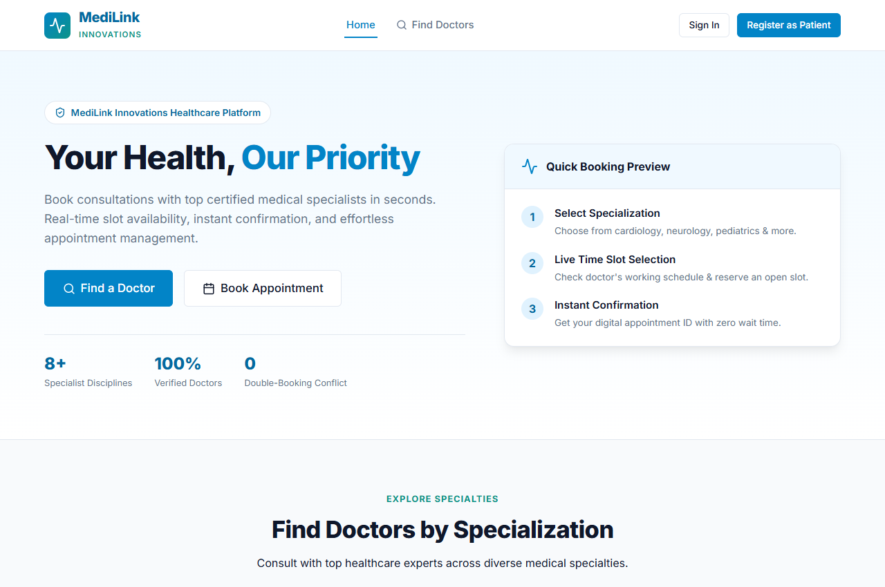
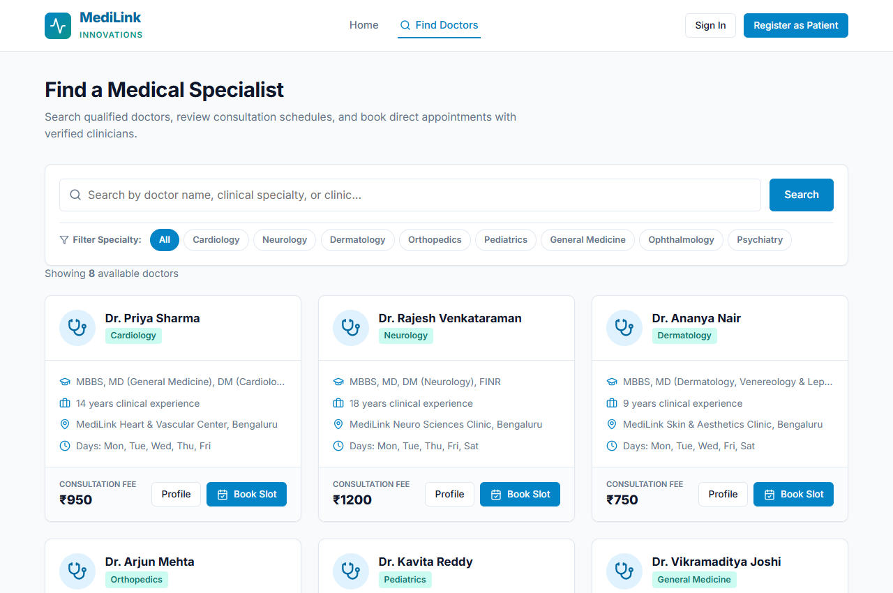
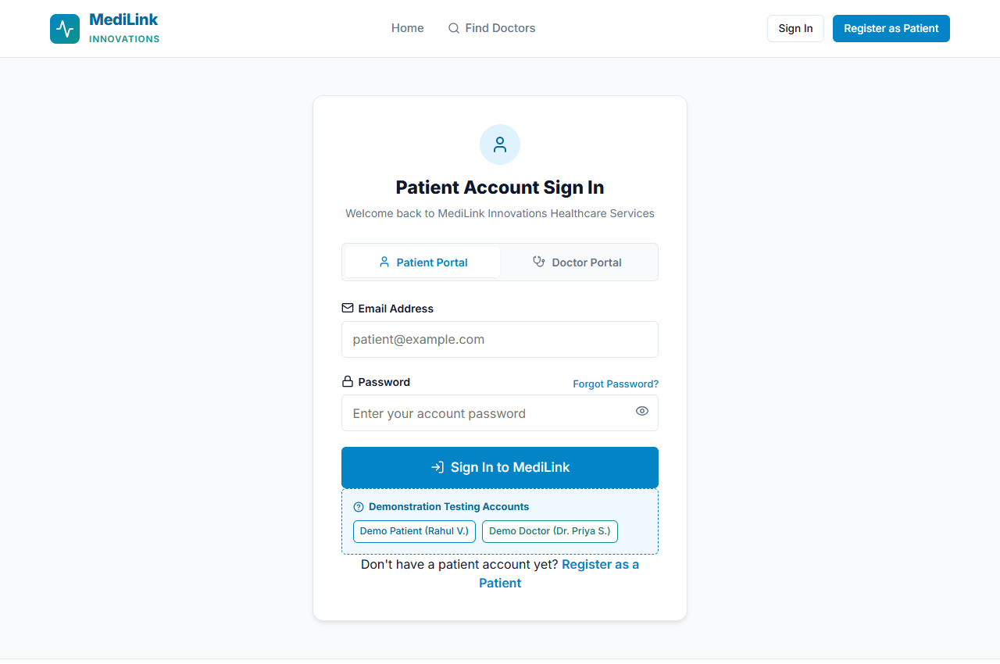
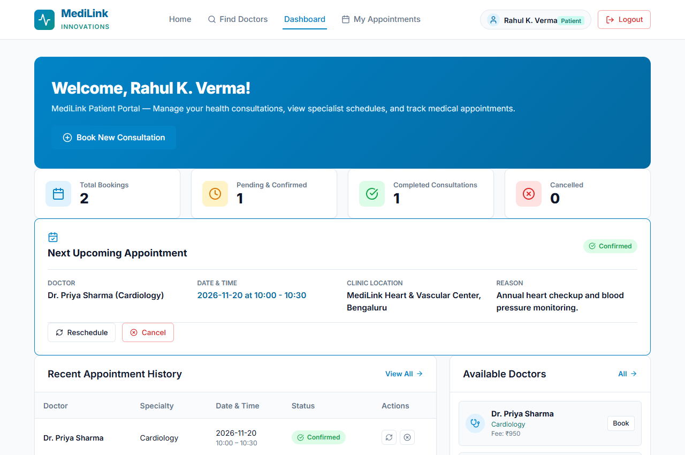
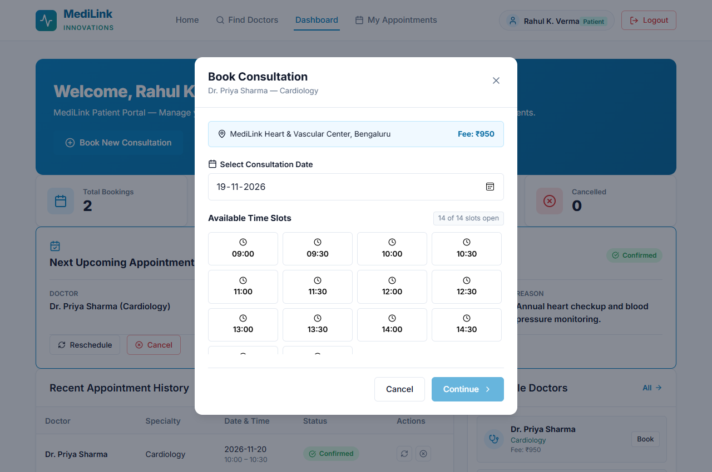
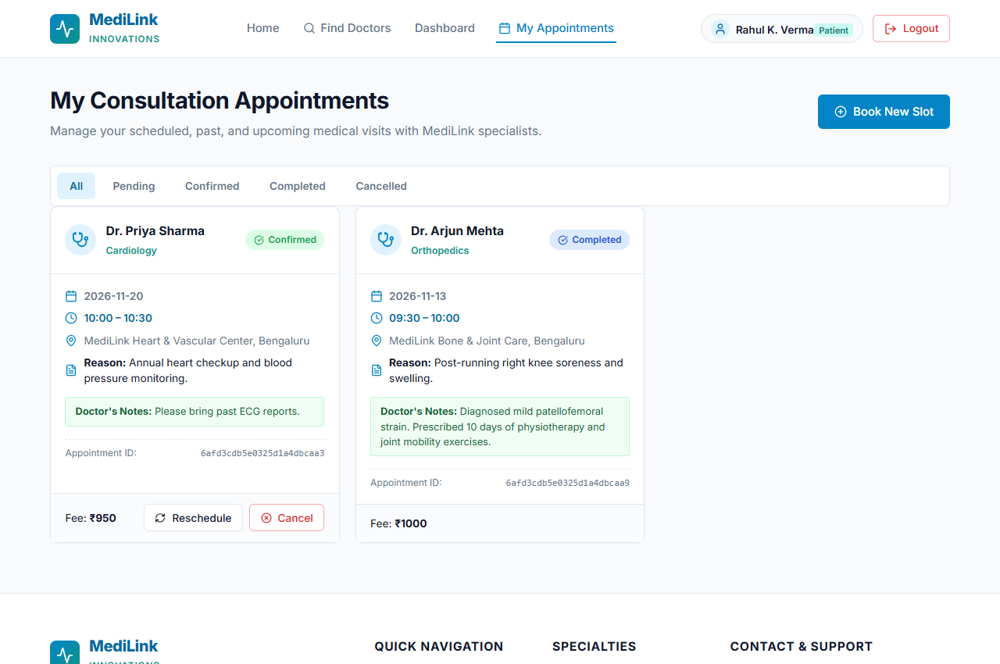
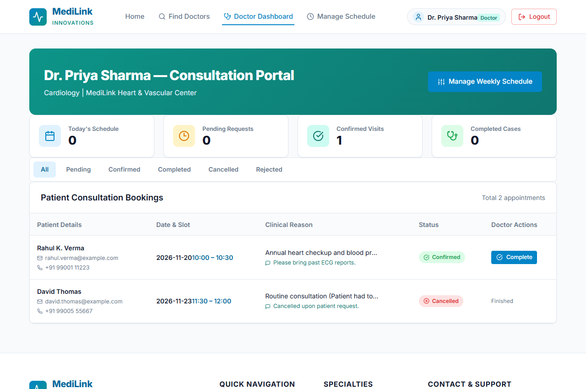
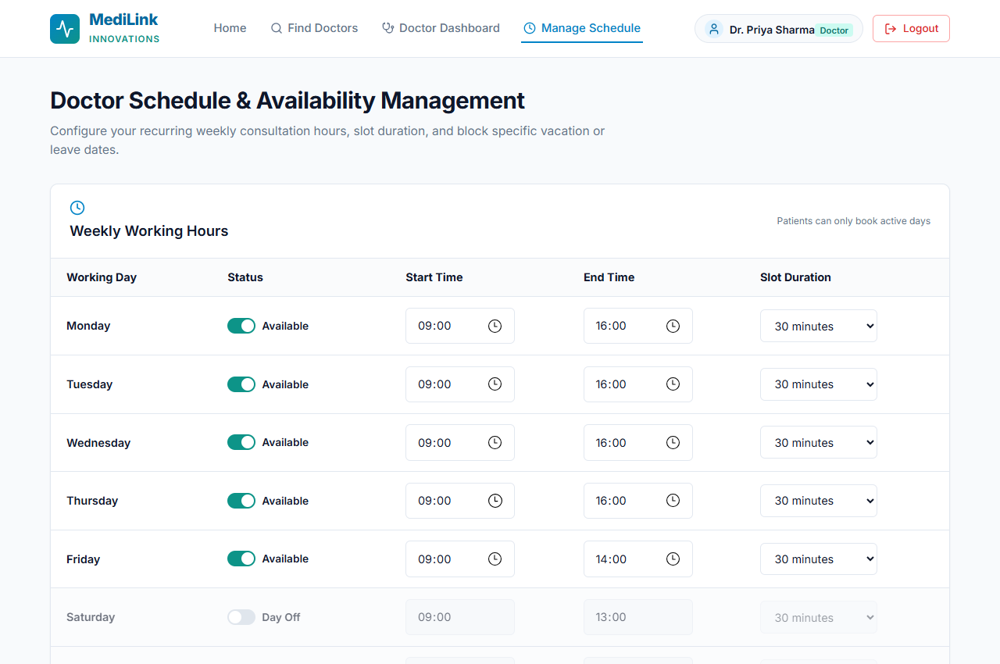

# Online Doctor Appointment Booking System — MediLink Innovations

[](https://nodejs.org/)
[](https://reactjs.org/)
[](https://vitejs.dev/)
[](https://mongoosejs.com/)
[](LICENSE)

A complete, professional, secure, and responsive full-stack MERN (MongoDB, Express.js, React.js, Node.js) web application engineered for **MediLink Innovations**. The system bridges medical specialists and patients, enabling real-time consultation scheduling, dynamic calendar slot generation, atomic double-booking prevention, doctor practice configuration, and role-based appointment lifecycle management.

---

## Table of Contents

- [Overview](#overview)
- [Key Features](#key-features)
  - [Patient Experience](#patient-experience)
  - [Doctor Experience](#doctor-experience)
  - [Security & Architecture](#security--architecture)
- [Technologies Used](#technologies-used)
- [Project Architecture & Directory Structure](#project-architecture--directory-structure)
- [Screenshots of the Running Website](#screenshots-of-the-running-website)
- [Installation & Local Setup Guide](#installation--local-setup-guide)
  - [Prerequisites](#prerequisites)
  - [1. Clone Repository](#1-clone-repository)
  - [2. Environment Configuration](#2-environment-configuration)
  - [3. Install Dependencies](#3-install-dependencies)
  - [4. Seed Demonstration Data](#4-seed-demonstration-data)
  - [5. Run the Application](#5-run-the-application)
- [Demonstration Accounts](#demonstration-accounts)
- [RESTful Backend API Documentation](#restful-backend-api-documentation)
- [Verification & Automated Test Suite](#verification--automated-test-suite)
  - [Test Case 1: Patient Registration](#test-case-1-patient-registration)
  - [Test Case 2: Doctor Search & Filtering](#test-case-2-doctor-search--filtering)
  - [Test Case 3: Appointment Booking](#test-case-3-appointment-booking)
  - [Test Case 4: Double Booking Prevention](#test-case-4-double-booking-prevention)
  - [Test Case 5: Appointment Cancellation & Slot Release](#test-case-5-appointment-cancellation--slot-release)
  - [Additional Integration Tests](#additional-integration-tests)
- [Concurrency & Double-Booking Strategy](#concurrency--double-booking-strategy)
- [Project Limitations](#project-limitations)

---

## Overview

MediLink Innovations' Online Doctor Appointment Booking System is designed to replace chaotic hospital queueing with an automated, transparent consultation scheduling interface. Patients can browse verified specialists across cardiology, neurology, pediatrics, orthopedics, dermatology, and general medicine, pick available slots computed from live working schedules, book consultations, and track appointment statuses. Doctors have dedicated dashboard access to set weekly consultation hours, manage slot intervals, block leave dates, and confirm, reject, or complete patient consultations with diagnostic notes.

---

## Key Features

### Patient Experience
- **Specialist Discovery**: Instant keyword search and one-click filtering across medical specialties.
- **Dynamic Slot Calendar**: Automatically computes available 30-minute intervals from each doctor's weekly consultation schedule minus existing active bookings.
- **Atomic Booking Flow**: 3-step modal flow (Date & Slot Selection → Clinical Reason & Review → Instant Confirmation with Unique Appointment ID).
- **Appointment Management**: View upcoming, pending, confirmed, completed, and cancelled consultations.
- **Rescheduling & Cancellation**: Reschedule consultations to new open slots without duplicate bookings, or cancel appointments to immediately release reserved slots.
- **Patient Profile**: Update personal details, contact phone, and email records.

### Doctor Experience
- **Doctor Consultation Portal**: Centralized dashboard displaying today's appointments, pending patient requests, confirmed visits, and completed consultations.
- **Status Lifecycle Control**: Approve or decline pending booking requests with valid status transition validation (`pending` → `confirmed` / `rejected`).
- **Clinical Completion Notes**: Mark consultations as completed and record diagnostic notes, prescribed medicines, and follow-up guidance.
- **Weekly Schedule Customization**: Configure consultation days (Mon–Sun), daily start/finish hours (e.g. 09:00–17:00), and slot durations (15, 30, 45, or 60 minutes).
- **Date Blocking**: Pause bookings on specific calendar dates (holidays, academic conferences, personal leave).
- **Professional Profile Editor**: Update qualifications, consultation fees (₹ INR), clinic address, and clinical summary.

### Security & Architecture
- **JWT via HTTP-Only Cookies**: Authentication tokens are transmitted exclusively through secure, HTTP-only, `SameSite=lax/strict` cookies. **Zero tokens are stored in `localStorage`**, eliminating XSS token theft.
- **Bcrypt Password Hashing**: Passwords hashed with 10 salt rounds prior to persistence.
- **Database-Level Concurrency Constraint**: Partial compound unique index on `{ doctorId: 1, appointmentDate: 1, startTime: 1 }` filtered for `status: { $in: ['pending', 'confirmed'] }`. This ensures absolute protection against race conditions and double bookings.
- **Helmet & CORS**: Strict HTTP response headers and origin controls.
- **Rate Limiting**: IP rate limiters on authentication endpoints to prevent brute-force attacks.

---

## Technologies Used

| Domain | Technology | Purpose |
|---|---|---|
| **Frontend UI** | React.js (v18.3) | Component-driven user interface |
| **Build Tool** | Vite (v6.x) | Fast bundling, hot module replacement, and production optimization |
| **Icons** | Lucide React | Clean, accessible healthcare SVG icons |
| **Routing** | React Router DOM (v6.28) | Client-side routing with role-based protected routes |
| **Styling** | Vanilla CSS3 (Custom Design System) | Modern white, light-blue (`#0284c7`), and teal (`#0d9488`) healthcare design |
| **Backend Runtime** | Node.js (v24.x) | Asynchronous backend server runtime |
| **API Framework** | Express.js (v4.21) | RESTful API routes, controllers, and middlewares |
| **Database** | MongoDB with Mongoose (v8.9) | Document data modeling, schema validation, and indexes |
| **Authentication** | JWT (`jsonwebtoken`) & `bcryptjs` | Stateless session verification with encrypted passwords |
| **Cookie Parsing** | `cookie-parser` | Extraction of HTTP-only JWT cookies |
| **Security** | Helmet & `express-rate-limit` | Secure HTTP headers and brute-force mitigation |
| **In-Memory Testing** | `mongodb-memory-server` | Automatic fallback for seamless execution without local MongoDB daemons |

---

## Project Architecture & Directory Structure

```text
Online-Doctor-Appointment-Booking-System/
├── client/                               # Frontend React + Vite Application
│   ├── public/
│   │   ├── favicon.svg                   # MediLink healthcare emblem
│   │   └── index.html
│   ├── src/
│   │   ├── components/
│   │   │   ├── AlertMessage.jsx          # Dismissible alert banners
│   │   │   ├── BookingModal.jsx          # 3-step dynamic slot booking modal
│   │   │   ├── DoctorCard.jsx            # Specialist directory card
│   │   │   ├── EmptyState.jsx            # Reusable empty data placeholder
│   │   │   ├── Footer.jsx                # Responsive healthcare footer
│   │   │   ├── LoadingSpinner.jsx        # Healthcare spinner with status messages
│   │   │   ├── Navbar.jsx                # Responsive header with role navigation
│   │   │   ├── ProtectedRoute.jsx        # Role-based auth protection
│   │   │   ├── RescheduleModal.jsx       # Real-time slot rescheduling modal
│   │   │   └── StatusBadge.jsx           # Color-coded appointment status pills
│   │   ├── context/
│   │   │   └── AuthContext.jsx           # Session state via HTTP-only cookies
│   │   ├── pages/
│   │   │   ├── DoctorDashboard.jsx       # Doctor consultation roster & actions
│   │   │   ├── DoctorSchedulePage.jsx    # Weekly hours & blocked dates editor
│   │   │   ├── DoctorsPage.jsx           # Specialist search & directory
│   │   │   ├── HomePage.jsx              # Landing page with hero & specialties
│   │   │   ├── LoginPage.jsx             # Role-toggle sign-in & demo logins
│   │   │   ├── MyAppointments.jsx        # Patient booking history & management
│   │   │   ├── PatientDashboard.jsx      # Patient metrics & quick appointment card
│   │   │   ├── ProfilePage.jsx           # User & clinician profile settings
│   │   │   └── RegisterPage.jsx          # New patient account registration
│   │   ├── services/
│   │   │   └── api.js                    # Centralized fetch API client
│   │   ├── styles/
│   │   │   └── index.css                 # Comprehensive healthcare design system
│   │   ├── App.jsx                       # Client route definitions
│   │   └── main.jsx                      # App root render
│   ├── package.json
│   └── vite.config.js
├── server/                               # Backend Node.js & Express.js API
│   ├── config/
│   │   └── db.js                         # MongoDB connection with in-memory fallback
│   ├── controllers/
│   │   ├── appointmentController.js      # Booking, rescheduling, cancellation, lifecycle
│   │   ├── authController.js             # Registration, login, logout, me
│   │   ├── doctorController.js           # Doctor query, availability, profile, schedule
│   │   └── profileController.js          # User profile management
│   ├── middleware/
│   │   ├── authMiddleware.js             # JWT verification & RBAC authorization
│   │   └── errorMiddleware.js            # Centralized error & conflict handling
│   ├── models/
│   │   ├── Appointment.js                # Schema with partial unique booking index
│   │   ├── DoctorProfile.js              # Specialization, fees, schedules, blocked dates
│   │   └── User.js                       # Account authentication and role models
│   ├── routes/
│   │   ├── appointmentRoutes.js
│   │   ├── authRoutes.js
│   │   ├── doctorRoutes.js
│   │   └── profileRoutes.js
│   ├── seed/
│   │   ├── seedData.js                   # 8 doctors, 5 patients, realistic appointments
│   │   └── seed.js                       # Executable seed runner
│   ├── tests/
│   │   ├── api.test.js                   # 5 core test cases + integration tests
│   │   └── capture-screenshots.js        # Automated headless browser screenshot runner
│   ├── app.js                            # Express app configuration & middleware
│   ├── server.js                         # Server entry point
│   └── package.json
├── screenshots/                          # Real captured screenshots of the platform
│   ├── 01-landing-page.png
│   ├── 02-find-doctors.png
│   ├── 03-patient-login.png
│   ├── 04-patient-dashboard.png
│   ├── 05-appointment-booking.png
│   ├── 06-my-appointments.png
│   ├── 07-doctor-dashboard.png
│   └── 08-doctor-schedule.png
├── .env.example                          # Environment variable template
├── .gitignore                            # Git exclusions
├── package.json                          # Root convenience runner
└── README.md
```

---

## Screenshots of the Running Website

### 1. Landing Page & Hero Section
*Modern white, light-blue, and teal branding with hero banner, specialty explorer, and featured specialists.*


### 2. Find Doctors Directory
*Doctor search by clinical keyword, instant filter by specialization, qualifications, and consultation fee in Indian Rupees (₹).*


### 3. Patient & Doctor Portal Sign In
*Clean sign-in interface with role toggle tabs, password visibility toggle, and instant demo test accounts.*


### 4. Patient Dashboard
*Personalized patient welcome, summary metric cards, upcoming appointment highlight, and recommended doctors.*


### 5. Interactive Appointment Booking Modal
*Live slot selection dynamically generated from the doctor's weekly consultation schedule and existing reservations.*


### 6. My Appointments Management
*Categorized tabs for All, Pending, Confirmed, Completed, and Cancelled appointments with reschedule and cancel actions.*


### 7. Doctor Dashboard & Consultations Roster
*Doctor consultation overview displaying today's appointments, pending booking requests, and Confirm/Reject actions.*


### 8. Doctor Schedule & Working Hours Management
*Comprehensive schedule configuration allowing clinicians to adjust daily working hours, slot duration, and block holiday dates.*


---

## Installation & Local Setup Guide

### Prerequisites
- [Node.js](https://nodejs.org/) (v18+ or v20+ recommended)
- [npm](https://www.npmjs.com/) (v9+)
- [MongoDB](https://www.mongodb.com/) (Optional: if not installed locally, the backend automatically starts an in-memory MongoDB instance for development and demonstration!)

### 1. Clone Repository
```bash
git clone https://github.com/sudharshanps/Online-Doctor-Appointment-Booking-System.git
cd Online-Doctor-Appointment-Booking-System
```

### 2. Environment Configuration
Copy `.env.example` to `server/.env`:
```bash
cp .env.example server/.env
```
Default configuration values in `server/.env`:
```env
NODE_ENV=development
PORT=5000
MONGODB_URI=mongodb://127.0.0.1:27017/medilink_db
JWT_SECRET=medilink_super_secret_jwt_key_intermediate_project_2026
JWT_EXPIRES_IN=7d
CLIENT_URL=http://localhost:5173
```

### 3. Install Dependencies
Install dependencies for both server and client:
```bash
# Install backend dependencies
cd server
npm install

# Install frontend dependencies
cd ../client
npm install

# Return to root
cd ..
```

### 4. Seed Demonstration Data
Populate MongoDB with 8 specialists across multiple fields, 5 patients, and realistic appointments:
```bash
cd server
npm run seed
```

### 5. Run the Application

#### Option A: Concurrent Development Mode
Run the backend API and frontend Vite server concurrently in two terminal windows:

**Terminal 1 (Backend API):**
```bash
cd server
npm start
# Server starts at http://localhost:5000/api
```

**Terminal 2 (Frontend Client):**
```bash
cd client
npm run dev
# Vite client starts at http://localhost:5173
```

#### Option B: Unified Production Server
Build the client and let the Express server host the full-stack application on port 5000:
```bash
cd client
npm run build
cd ../server
npm start
# Visit http://localhost:5000 in your browser!
```

---

## Demonstration Accounts

All demo accounts are pre-seeded with the password: **`password123`**

### Doctor Demonstration Accounts
| Doctor Name | Email Address | Specialization | Consultation Fee |
|---|---|---|---|
| **Dr. Priya Sharma** | `priya.sharma@medilink.com` | Cardiology | ₹950 |
| **Dr. Rajesh Venkataraman** | `rajesh.v@medilink.com` | Neurology | ₹1,200 |
| **Dr. Ananya Nair** | `ananya.nair@medilink.com` | Dermatology | ₹750 |
| **Dr. Arjun Mehta** | `arjun.mehta@medilink.com` | Orthopedics | ₹1,000 |
| **Dr. Kavita Reddy** | `kavita.reddy@medilink.com` | Pediatrics | ₹700 |
| **Dr. Vikramaditya Joshi** | `vikram.joshi@medilink.com` | General Medicine | ₹600 |
| **Dr. Sneha Roy** | `sneha.roy@medilink.com` | Ophthalmology | ₹800 |
| **Dr. Farhan Siddiqui** | `farhan.siddiqui@medilink.com` | Psychiatry | ₹1,100 |

### Patient Demonstration Accounts
| Patient Name | Email Address | Phone |
|---|---|---|
| **Rahul K. Verma** | `rahul.verma@example.com` | +91 99001 11223 |
| **Meera Iyer** | `meera.iyer@example.com` | +91 99002 22334 |
| **Amitabh Sen** | `amitabh.sen@example.com` | +91 99003 33445 |
| **Pooja Chawla** | `pooja.chawla@example.com` | +91 99004 44556 |
| **David Thomas** | `david.thomas@example.com` | +91 99005 55667 |

---

## RESTful Backend API Documentation

### Authentication (`/api/auth`)
| Method | Endpoint | Access | Description |
|---|---|---|---|
| `POST` | `/api/auth/register` | Public | Register a new patient account & receive HTTP-only cookie |
| `POST` | `/api/auth/login` | Public | Authenticate patient or doctor with role verification |
| `POST` | `/api/auth/logout` | Public | Clear HTTP-only session cookie |
| `GET` | `/api/auth/me` | Authenticated | Retrieve current session profile and doctor credentials |

### Doctors (`/api/doctors`)
| Method | Endpoint | Access | Description |
|---|---|---|---|
| `GET` | `/api/doctors` | Public | List all doctors with `search` & `specialization` filters |
| `GET` | `/api/doctors/:id` | Public | Get single doctor details, qualifications, and clinic |
| `GET` | `/api/doctors/:id/availability` | Public | Generate real-time available/booked time slots for a specific date |
| `PUT` | `/api/doctors/profile` | Doctor Only | Update doctor clinical profile, qualifications, clinic, and fee |
| `PUT` | `/api/doctors/schedule` | Doctor Only | Update recurring weekly hours and blocked holiday dates |

### Appointments (`/api/appointments`)
| Method | Endpoint | Access | Description |
|---|---|---|---|
| `POST` | `/api/appointments` | Patient Only | Book an appointment slot with atomic double-booking check |
| `GET` | `/api/appointments/my` | Patient Only | List patient's bookings with optional status filter |
| `GET` | `/api/appointments/doctor` | Doctor Only | List doctor's bookings with patient contact metadata |
| `PATCH` | `/api/appointments/:id/status` | Doctor Only | Transition status (`confirmed`, `rejected`, `completed`) |
| `PATCH` | `/api/appointments/:id/reschedule` | Patient/Doctor | Change appointment date/slot with conflict validation |
| `PATCH` | `/api/appointments/:id/cancel` | Patient/Doctor | Cancel appointment and immediately release the time slot |

### User Profile (`/api/profile`)
| Method | Endpoint | Access | Description |
|---|---|---|---|
| `GET` | `/api/profile` | Authenticated | Retrieve user profile information |
| `PUT` | `/api/profile` | Authenticated | Update user name, contact phone, and email |

---

## Verification & Automated Test Suite

The project includes an automated test runner (`server/tests/api.test.js`) verifying all 5 core requirements plus security policies.

To execute the test suite:
```bash
cd server
npm test
```

### Verified Test Results

```text
============================================================
 Starting MediLink Innovations Automated Test Suite
============================================================

▶ [TEST 1] Patient Registration
  ✔ Patient registered and verified in MongoDB successfully.

▶ [TEST 2] Doctor Search (Cardiologist search)
  ✔ Successfully retrieved cardiologist: Dr. Priya Sharma (Cardiology).

▶ [TEST 3] Appointment Booking
  ✔ Appointment booked & saved in MongoDB (ID: 6afd3cfb71a0b8000a1380ae).

▶ [TEST 4] Double Booking Prevention
  ✔ Backend successfully prevented double booking (returned 409 Conflict).

▶ [TEST 5] Appointment Cancellation & Slot Release
  ✔ Slot was released upon cancellation and successfully rebooked by another patient.

▶ [ADDITIONAL TEST] Appointment Rescheduling
  ✔ Rescheduled appointment successfully to 09:30.

▶ [ADDITIONAL TEST] Doctor Login & Schedule Update
  ✔ Doctor schedule updated and blocked date (2026-12-25) recognized.

▶ [ADDITIONAL TEST] Unauthorized Access & Logout
  ✔ Logout cleared session and protected endpoint denied unauthenticated access.

============================================================
 ALL 5 CORE TEST SCENARIOS + ADDITIONAL TESTS PASSED 100%! 
============================================================
```

### Test Case Explanations

#### Test Case 1: Patient Registration
- **Input**: POST `/api/auth/register` with name, email, password, and phone number.
- **Verification**: Verifies that the password is not stored in plaintext, the user record is persisted in MongoDB, an HTTP-only JWT cookie is returned, and status 201 is returned.

#### Test Case 2: Doctor Search & Filtering
- **Input**: GET `/api/doctors?specialization=Cardiology`.
- **Verification**: Verifies that only cardiologist profiles (e.g. Dr. Priya Sharma) are returned, with populated doctor credentials, qualifications, clinic location, and consultation fee in INR (₹).

#### Test Case 3: Appointment Booking
- **Input**: POST `/api/appointments` reserving slot 09:00–09:30 on an upcoming weekday.
- **Verification**: Verifies that the appointment is inserted with status `pending`, referenced to the correct patient and doctor, and returns an official Appointment ID.

#### Test Case 4: Double Booking Prevention
- **Input**: A second patient attempts to book the exact same doctor, date, and startTime (09:00).
- **Verification**: Verifies that the backend rejects the conflicting request with HTTP status `409 Conflict` and error message `"This time slot is already reserved. Please select another slot."`

#### Test Case 5: Appointment Cancellation & Slot Release
- **Input**: PATCH `/api/appointments/:id/cancel`.
- **Verification**: Verifies that the appointment status updates to `cancelled`. Subsequently, the same time slot is immediately booked by another patient, proving that the slot was released cleanly without conflict.

---

## Concurrency & Double-Booking Strategy

To ensure zero double-booking conflicts across concurrent client requests, MediLink implements a two-tier strategy:

1. **Application-Level Pre-Flight Validation**:
   The controller queries MongoDB for existing active appointments:
   ```javascript
   const conflict = await Appointment.findOne({
     doctorId,
     appointmentDate,
     startTime,
     status: { $in: ['pending', 'confirmed'] }
   });
   if (conflict) {
     return res.status(409).json({ message: 'This time slot is already reserved.' });
   }
   ```

2. **Database-Level Partial Unique Index**:
   In `Appointment.js`, a partial filter unique compound index is created:
   ```javascript
   appointmentSchema.index(
     { doctorId: 1, appointmentDate: 1, startTime: 1 },
     {
       unique: true,
       partialFilterExpression: {
         status: { $in: ['pending', 'confirmed'] }
       }
     }
   );
   ```
   - **Why Partial Filter?** When an appointment is `cancelled` or `rejected`, MongoDB excludes it from the unique index, allowing the exact slot to be immediately reserved by another patient.
   - **Race Condition Immunity**: Even if two patients click "Confirm Booking" at the exact same millisecond, MongoDB's atomic index guarantees only one document is committed, while the second receives an `E11000` duplicate key exception handled gracefully as a `409 Conflict`.

---

## Project Limitations

- **Educational Scope**: Designed as an intermediate full-stack appointment booking system; does not include Electronic Health Record (EHR) compliance (e.g. HIPAA / GDPR-Health).
- **Payment Gateway**: Consultation fees are displayed in Indian Rupees (₹), but real financial payment gateway integration (e.g., Razorpay / Stripe) is not included; fees are settled during consultation.
- **Real-Time WebSockets**: Slot availability is polled upon calendar date change rather than using WebSockets.
- **Notification Services**: Appointment confirmation is presented via UI and MongoDB records; automated SMS or WhatsApp gateway dispatches are not integrated.

---

*Engineered with precision for MediLink Innovations.*
